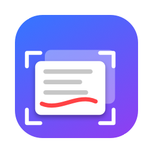

<p align="center">
  
</p>

<h1 align="center">FloatShot</h1>

<p align="center">
  Floating screenshots for macOS, Windows and Linux.<br>
  Capture a region, pin it on top of everything, annotate it, pull the text out, or record your screen.
</p>

<p align="center">
  <a href="https://github.com/dsomid/FloatShot/releases/latest"></a>
  
  <a href="CHANGELOG.md"></a>
</p>

## Features

| | macOS | Windows / Linux |
| --- | :---: | :---: |
| Region capture hotkey | ⇧⌘2 | Ctrl+Shift+2 |
| Floating always-on-top shots | ✅ | ✅ |
| Draw, highlight, arrows, circles, squares, blur and typed notes, with undo (⌘Z / Ctrl+Z) | ✅ | ✅ |
| OCR (text from image) | ✅ Apple Vision | ✅ Tesseract |
| Right-click: Copy Image, Copy Text, Delete | ✅ | ✅ |
| Right-click: AirDrop text or image | ✅ | — |
| Right-click: Save Image | ✅ | ✅ |
| Record screen / record region | ✅ `.mov` | ✅ `.mp4` |
| Recording frame + click-to-stop timer | ✅ | — |
| Custom shortcut for every action | ✅ | ✅ |
| Open at Login | ✅ | ✅ |

Shots stay put until you click the red **✕** or right-click and choose **Delete**. Change any shortcut in **Settings…** from the menu-bar (or tray) icon.

## Install

Downloads are on the [latest release](https://github.com/dsomid/FloatShot/releases/latest) page.

### macOS (14 Sonoma or later)

With [Homebrew](https://brew.sh):

```bash
brew tap dsomid/tap && brew trust dsomid/tap
brew install --cask dsomid/tap/floatshot
```

Homebrew only loads casks from third-party taps you've trusted, hence `brew trust`. Or download `FloatShot-<version>.dmg` and drag FloatShot to Applications.

FloatShot isn't notarized by Apple, so macOS blocks the first launch. Open it once, then go to **System Settings → Privacy & Security** and click **Open Anyway**. (On macOS 14 you can instead right-click the app and choose **Open**.) After granting Screen Recording permission, quit FloatShot from the menu bar and open it again.

```bash
brew upgrade --cask floatshot
brew uninstall --cask floatshot
```

### Windows 10/11

Download **`FloatShot-windows-x64.exe`** and double-click it. That's the whole app in one file, nothing to install. If SmartScreen warns, click **More info → Run anyway**. FloatShot lives in the system tray.

Prefer faster startup? Download `FloatShot-windows-x64.zip` instead, unzip it, and run `FloatShot\FloatShot.exe`.

For OCR, install [Tesseract](https://github.com/UB-Mannheim/tesseract/wiki) and make sure it's on your PATH.

### Linux (X11)

```bash
tar -xzf FloatShot-linux-x64.tar.gz
./FloatShot/FloatShot
```

Needs a desktop with a system tray. For OCR: `sudo apt install tesseract-ocr`. On Wayland, FloatShot runs through XWayland; the global hotkey and capture may be limited by your compositor, so use the tray menu if the hotkey doesn't respond.

## Version history

See [CHANGELOG.md](CHANGELOG.md) for what changed in each version, or the [Releases](https://github.com/dsomid/FloatShot/releases) page.

## Build from source

### macOS

Needs the Xcode command line tools.

```bash
./build.sh
```

This produces `build/FloatShot.app` (universal) and `build/FloatShot-<version>.dmg`. The version comes from `CFBundleShortVersionString` in `Info.plist`.

If a code-signing identity named `FloatShot Local Signing` is in your keychain, the build uses it, which keeps the Screen Recording permission across rebuilds. Otherwise it signs ad-hoc.

To redraw the icon after editing `make_icon.swift`:

```bash
swift make_icon.swift build/AppIcon.iconset && iconutil -c icns build/AppIcon.iconset -o AppIcon.icns
```

### Windows / Linux

Needs Python 3.12.

```bash
cd linux-windows
pip install -r requirements.txt
python floatshot.py
```

Release binaries are built by [GitHub Actions](.github/workflows/release.yml) with PyInstaller whenever a release is published.

## Releasing a new version

1. Update the version in `Info.plist` and `VERSION` in `linux-windows/floatshot.py`, and add an entry to `CHANGELOG.md`.
2. Run `./build.sh`, then commit and push.
3. `gh release create v<version> build/FloatShot-<version>.dmg --notes-file <notes>`. GitHub Actions then adds the Windows and Linux downloads.
4. Update `version` and `sha256` in [`dsomid/homebrew-tap`](https://github.com/dsomid/homebrew-tap)'s `Casks/floatshot.rb`.

## Project layout

| Path | Purpose |
| --- | --- |
| `Sources/main.swift` | macOS app: hotkey, selection overlay, ScreenCaptureKit capture and recording, floating panel, annotation, OCR, sharing |
| `Info.plist` | macOS bundle metadata and version |
| `build.sh` | Compiles, signs, and packages the DMG |
| `make_icon.swift` / `AppIcon.icns` | App icon generator and output |
| `linux-windows/` | Windows and Linux app (Python + Qt) |
| `.github/workflows/release.yml` | Builds Windows and Linux downloads for each release |
| `CHANGELOG.md` | Version history |
